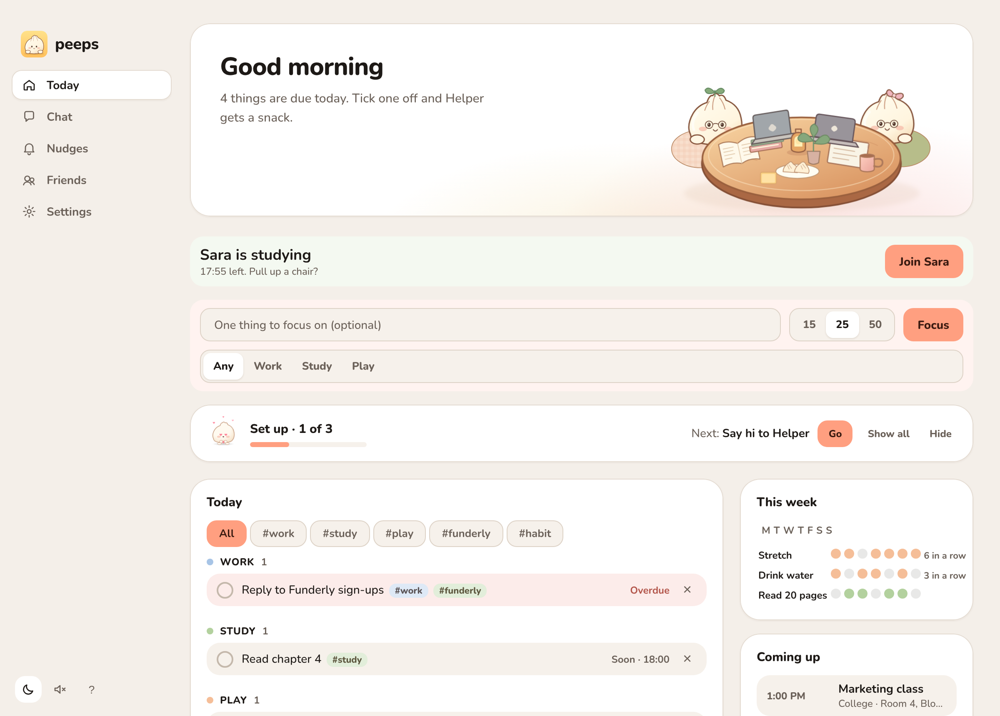
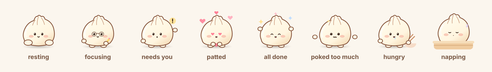
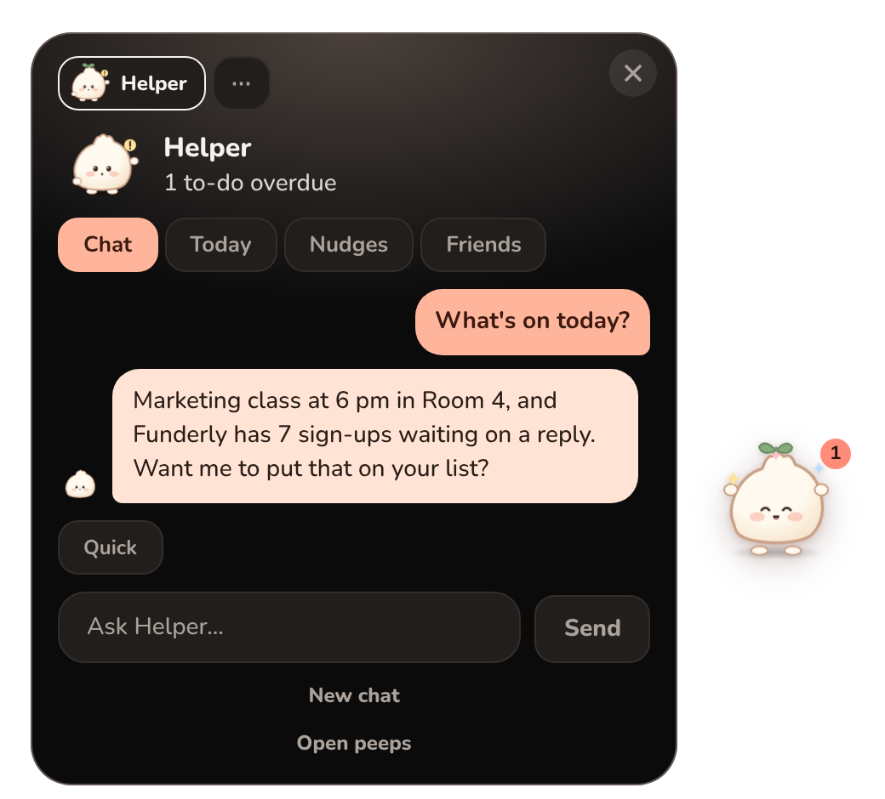
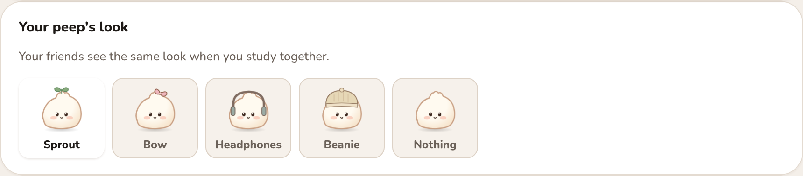

<div align="center">


# peeps

**A little dumpling that keeps you on top of your day.**

For Mac and Windows · free · no account

[**Download**](../../releases/latest) · [What it does](#what-it-does) · [Install](#install) · [Privacy](#privacy)

<br>



</div>

<br>

peeps lives on your desktop as a small cream bun. It knows what's on today, nudges you to stretch and drink water, sits with you while you focus, and studies with your friends at a little wooden table. Pat it, feed it, pick it up: it squishes back.

<p align="center">
  
</p>

## What it does

<table>
<tr>
<td width="50%" valign="top">

### 🗓️ Your day, in one place

To-dos with `#tags`, dates and repeats, grouped into **Work**, **Study**, **Play** or your own areas, plus what's coming up from your calendars. A week of dots for every habit. Tick something off and your peep gets a snack.

### 💬 Chat with your peep

Talk to it through your own Claude. "Remind me to call mum at 6" becomes a reminder, and "move gym to Thursday" moves it. It remembers what you tell it about you, and asks before doing anything.

### 🔔 Gentle nudges

Stretch, drink water, rest your eyes, each with its own switch. When one is due, your peep waves and says so in a bubble, with **Done** and **Later**.

</td>
<td width="50%" valign="top">



</td>
</tr>
</table>

### 📚 Study together

Swap codes with friends. When you're both focusing, your peep turns into a low wooden table and everyone sits around it with their laptops and books, glasses on. Hover a bun to see who it is. Send a steamy heart, a chopstick poke, a rolling-pin bonk or a tea break. Messages are sealed, so the relay that carries them can't read them.

<p align="center">
  
</p>

### 🎀 Make it yours

Give your peep a sprout, a bow, headphones or a beanie, and your friends see the same look at their table. Make it small, medium or large, and keep it at the top of the screen or floating anywhere.

<p align="center">
  
</p>

### And also

- **Focus sessions:** 15, 25 or 50 minutes; your peep works alongside, then calls a break.
- **One thing at a time:** optional; if you keep hopping between apps, it suggests what to do first. It only sees app names, on your computer.
- **Play:** click for a pat, click a lot and it gets dizzy, drag it around and it dangles, drop a file on it and it joins your next message.
- **Every computer, no account:** pick a folder in iCloud Drive, OneDrive, Dropbox or Google Drive and your Mac and PC stay in step.
- **Light or dark,** with an optional boop sound.

## Install

### 1. Download one file

Open the [latest release](../../releases/latest) and download the one for your computer:

| Your computer                            | Download                |
| ---------------------------------------- | ----------------------- |
| **Mac with Apple chip** (M1, M2, M3, M4) | `peeps_…_aarch64.dmg`   |
| **Mac with Intel chip**                  | `peeps_…_x64.dmg`       |
| **Windows**                              | `peeps_…_x64-setup.exe` |
| Linux                                    | `.AppImage` or `.deb`   |

Not sure which Mac you have? Apple menu → **About This Mac**. "Chip: Apple M…" means Apple chip.

You can ignore the other files: `.app.tar.gz` and `latest.json` are what peeps downloads when it updates itself.

### 2. Open it the first time

peeps isn't code-signed yet, so your computer asks once:

- **Mac:** open the `.dmg`, drag **peeps** into **Applications**, then in Applications **right-click** peeps → **Open** → **Open**.
  If it says peeps "is damaged" or "can't be opened", go to System Settings → Privacy & Security, scroll down and click **Open Anyway**.
- **Windows:** run the installer. On the blue "Windows protected your PC" box, click **More info** → **Run anyway**.

### 3. Say hi

peeps opens with a short tour. Say hi in **Chat** so it gets to know you, then switch on a nudge or two. Chat uses Claude Code, which comes with a Claude account; if it isn't installed, **Settings** installs it in one click.

### Updates

You only install by hand once. peeps checks for a new version when it starts and every few hours; when one is out, **Settings** shows **Restart to update**. Nothing downloads or restarts until you press it.

### Build from source

Requirements: Rust 1.82+, Node 20+, and on Linux the [Tauri system packages](https://tauri.app/start/prerequisites/).

```sh
npm install
npm run tauri build
```

## Configuration

Everything is set in the app. Finer settings live in `~/.peeps/config.toml`; what you tell your peep about you is in `about-me.md` beside it.

```toml
[helper]
name = "Bao"
model = "sonnet"     # or opus, haiku; unset uses a quick model
effort = "medium"    # low, medium or high
chat_command = ["claude", "-p", "--output-format", "json"]
```

Each message goes to `chat_command` on stdin. Config files from older versions may still have `[[mail]]`, `[paypal]`, `[[product.teammate]]`, `youtube_channel`, `command` or `voices`; peeps ignores them.

## How it works

```
to-dos, calendars ──▶ peeps app ──▶ notch or floating window
                          │  ▲
            your Claude ◀─┘  └── reminders, nudges
```

- `crates/core`: config, checks, sessions, moods, token usage, notes and the hook protocol. No UI code, fully unit tested.
- `crates/hook`: the small binary agents run. If the app is closed it exits silently, so agents are never blocked.
- `src-tauri`: the desktop app. Runs the socket server, the check scheduler and the window.
- `src`: the React interface and the dumplings.

More in [docs/architecture.md](docs/architecture.md).

## Develop

```sh
npm run dev            # interface in a browser with demo data
npm run tauri dev      # the full app
cargo test --workspace
npm test
npm run e2e            # each use case in docs/use-cases.md, in a real browser
```

## Releasing (for maintainers)

1. **Once:** add the signing key as a repository secret. Settings → Secrets and variables → Actions → New repository secret, named `TAURI_SIGNING_PRIVATE_KEY`, holding the one long line inside the private key file. The `.key` file is plain text: open it with TextEdit or Notepad, not by double-clicking (a Mac hands `.key` files to Keynote). The key has no password, so `TAURI_SIGNING_PRIVATE_KEY_PASSWORD` stays unset.
2. **Each release:** Actions → **Release** → **Run workflow**, choose **patch**, **minor** or **major**, and press Run.

The workflow raises the version in every file that carries it (`scripts/bump-version.mjs`), commits and tags it, builds every platform and publishes the release with `latest.json`, which installed copies read from `releases/latest/download/latest.json`. If a run fails after the version step, use **Re-run failed jobs** to keep the same version. Pushing a `v*` tag yourself builds that tag as it is.

Keep the private key safe: installed copies only accept updates signed with it. A new pair comes from `npm run tauri signer generate -- -w ~/.tauri/peeps.key`, with the public half in `src-tauri/tauri.conf.json` under `plugins.updater.pubkey`.

## Roadmap

- Focus together: start a session with a friend
- iPhone companion

## Privacy

No account, no telemetry, no server. Data stays in `~/.peeps`. Secrets live in your OS keychain. The only network calls are your calendar links, the chats you start (through your own Claude), a look at the latest GitHub release for updates and, if you add friends, sealed messages through ntfy.sh.

## License

MIT
