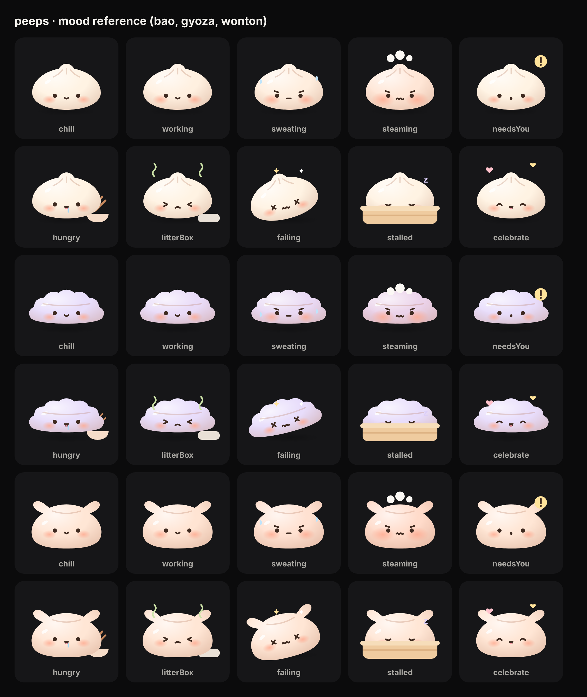

# Rive kit

Everything needed to animate the pets in [Rive](https://rive.app). The app swaps the current SVG pets for the Rive files once they exist, so the names below are a contract: keep them exactly.

## Style

Soft and plush, no outlines: a pastel body, a warm shade towards the edges, a white glow top left, and a few faint creases. Faces are small and low: solid dot eyes, a tiny mouth, big soft blush.

## Files

| File          | What it is                                                                    |
| ------------- | ----------------------------------------------------------------------------- |
| `bao.svg`     | The bao, every part on its own named layer. Alternative faces start hidden.   |
| `gyoza.svg`   | The gyoza with its crimped edge, same layers and names.                       |
| `wonton.svg`  | The wonton purse with folded corners, same layers and names.                  |
| `moods.png`   | Which layers make up each mood.                                               |
| `generate.py` | Rebuilds the SVGs from `src/pets/shapes.json`, the shapes the app also draws. |

Import each SVG into its own Rive file. Rive keeps the group names as layer names.

## Layers

| Layer                                                                                                      | Use                                           |
| ---------------------------------------------------------------------------------------------------------- | --------------------------------------------- |
| `shadow`                                                                                                   | Squashes and fades with jumps                 |
| `props-back` › `bowl`, `litter-box`                                                                        | Objects beside the pet                        |
| `pet` › `body-group` › `body`, `shade`, `glow`, `highlight`, `creases`                                     | The dumpling; `body` takes the product colour |
| `blush` › `blush-left`, `blush-right`                                                                      | Grows with heat                               |
| `eyes` › `eyes-open` (`eye-left`, `eye-right`), `eyes-closed`, `eyes-happy`, `eyes-x`, `eyes-squint`       | One visible at a time                         |
| `brows`                                                                                                    | Effort and frustration                        |
| `mouth` › `mouth-smile`, `mouth-o`, `mouth-flat`, `mouth-wavy`, `mouth-frown`, `mouth-open-smile`, `drool` | One mouth visible at a time; `drool` adds on  |
| `props-front` › `steamer`                                                                                  | The bamboo steamer the pet naps in            |
| `fx` › `fx-bang`, `fx-sweat`, `fx-steam`, `fx-zzz`, `fx-stink`, `fx-stars`, `fx-hearts`                    | Effects around the pet                        |

Redraw anything you like. Keep the layer names so the states below still make sense.

## Artboard

- One artboard per file, named **`Bao`**, **`Gyoza`** or **`Wonton`**, 240 × 200.
- The pet sits on the bottom edge, centred. Effects may use the space above it.
- Leave the background transparent.

## State machine: `Mood`

### Inputs

| Input       | Type    | Values                                                                                                      |
| ----------- | ------- | ----------------------------------------------------------------------------------------------------------- |
| `mood`      | Number  | 0 chill · 1 working · 2 sweating · 3 steaming · 4 needsYou · 5 hungry · 6 litterBox · 7 failing · 8 stalled |
| `heat`      | Number  | 0 to 100: how fast the product is burning tokens                                                            |
| `celebrate` | Trigger | An agent finished its work                                                                                  |
| `poke`      | Trigger | The user clicked the pet                                                                                    |
| `fed`       | Trigger | The user left the pet a note                                                                                |

### States

Each `mood` value is one looping state. Blend between states over about 200 ms so mood changes never snap.

| `mood`        | Layers                                                 | Motion                                                                      |
| ------------- | ------------------------------------------------------ | --------------------------------------------------------------------------- |
| 0 `chill`     | `eyes-open`, `mouth-smile`                             | Slow breathing squash, a blink every 3 to 5 s                               |
| 1 `working`   | `eyes-open`, `mouth-smile`                             | Quick bob; eyes glance left and right as if reading                         |
| 2 `sweating`  | `eyes-open`, `brows`, `mouth-flat`, `fx-sweat`         | Faster bob; drops slide down and fade, one at a time                        |
| 3 `steaming`  | `eyes-open`, `brows`, `mouth-wavy`, `fx-steam`         | Small jitter; puffs rise, grow and fade in turn                             |
| 4 `needsYou`  | `eyes-open`, `mouth-o`, `fx-bang`                      | Hops with squash on landing; `!` pulses. The most attention-grabbing state. |
| 5 `hungry`    | `eyes-open`, `mouth-open-smile`, `drool`, `bowl`       | Leans towards the bowl with its chopsticks and back; drool stretches        |
| 6 `litterBox` | `eyes-squint`, `mouth-frown`, `fx-stink`, `litter-box` | Shuffles away from the box; stink lines wave upwards                        |
| 7 `failing`   | `eyes-x`, `mouth-wavy`, `fx-stars`                     | Tipped over about 14°, gentle wobble; stars orbit the head                  |
| 8 `stalled`   | `eyes-closed`, `steamer`, `fx-zzz`                     | Naps in the steamer: very slow breathing, z floats up and fades             |

### Heat (any state)

`heat` runs in its own layer of the state machine so it combines with every mood. Use a 1D blend from 0 to 100:

- `blush` grows to about 1.7× at 100, spreading across the cheeks. This carries most of the flush.
- `body` warms slightly towards coral, about 15% at 100. Pastels turn muddy if pushed further.

### One-shot triggers

Each plays once on top of the current state, then returns to it:

- `celebrate`: a jump with `eyes-happy`, `mouth-open-smile` and `fx-hearts`, about 1 s.
- `poke`: squash and a quick surprised `mouth-o`. Three pokes in two seconds: dizzy with `fx-stars` for 2 s.
- `fed`: mouth opens, chomps twice, a happy wiggle.

## Product colour

Each product picks its own colour, so `body` must take it at runtime. Add a **View Model** named `Pet` with a colour property `bodyColor` and bind it to the fill of `body`. The app sets `bodyColor` for every pet.

## Handing over

Export `bao.riv`, `gyoza.riv` and `wonton.riv` into `src/pets/rive/`. Keep the source `.rev` files too, so changes stay possible later. The app falls back to the SVG pets whenever a `.riv` file is missing.
